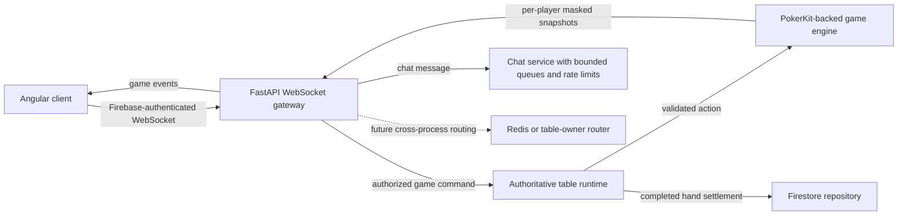

# WebSocket Architecture and PokerKit Fit

## Purpose

This document evaluates the proposed topic-based game and chat WebSocket design against the current Cowboys PH Poker backend. The proposal is a possible direction for future scaling; its sample code is not a drop-in replacement for the current protocol.

## Current Backend

The current implementation is a single-process, authoritative table flow:

1. A player connects to `/ws/table/{club_id}/{table_id}` or `/ws/union/{union_id}/{table_id}`.
2. The server requires a Firebase ID token in the first WebSocket message, checks active membership and `PLAYER` role, and confirms the user is seated. Union sockets also verify the selected home club.
3. The server sends an authentication acknowledgement and a player-specific full state snapshot. Hole-card masking is performed for each player.
4. Incoming actions are validated and passed to `TableRuntime`, which serializes mutations with an `asyncio.Lock` and calls the PokerKit-backed game engine.
5. After an accepted action, the runtime broadcasts a fresh, masked snapshot to each connected player. Invalid actions return an error to the acting socket.
6. Completed hands are handed to the repository for idempotent Firestore settlement. Firestore's gRPC transport is an implementation detail, not the application protocol.

The current protocol supports both the legacy message shape and an opt-in version `1.0` envelope. V1 wraps authentication, player actions, pre-actions, acknowledgements, errors, and full table snapshots. It does not add action deltas, Redis, chat, or global-game sockets. Table and connection state are process-local, so multiple application workers do not currently share one authoritative table state.

## What the UI Does

The WebSocket does not create or start a table. The UI uses REST to create the table, seat players, and start each hand. It opens a WebSocket for a seated player to receive their initial player-specific snapshot and then use the same connection for game messages.

For a local club table:

1. An `OWNER` or `MANAGER` creates the table with `POST /clubs/{club_id}/tables/{table_id}`.
2. Each `PLAYER` buys in and takes a seat with `POST /clubs/{club_id}/tables/{table_id}/seats`.
3. Each seated player connects to `/ws/table/{club_id}/{table_id}` and authenticates.
4. An `OWNER` or `MANAGER` starts the hand with `POST /clubs/{club_id}/tables/{table_id}/hands`.
5. Connected players receive a new WebSocket snapshot. Players send actions over that same socket; accepted actions cause another snapshot broadcast.

For a cross-club union table, the club players do **not** connect to each other's private club tables. They join the same table scoped to a union:

1. A `UNION_ADMIN` creates the shared table with `POST /unions/{union_id}/tables/{table_id}`, choosing an active member club as the origin.
2. A player from Club A takes a seat using `POST /unions/{union_id}/tables/{table_id}/clubs/{club_a_id}/seats`; a player from Club B uses the same endpoint with `club_b_id`.
3. Both players connect to `/ws/union/{union_id}/{table_id}`. Each authenticates with their own Firebase token and their own verified home-club ID.
4. A `UNION_ADMIN` starts the hand with `POST /unions/{union_id}/tables/{table_id}/hands`.
5. The shared union runtime broadcasts state to all connected players across the participating clubs. Each player receives a separately masked snapshot, and each player entry includes its verified `club_id` so the UI can show the player's club.

Starting a hand broadcasts to players already connected. If a player connects after the hand starts, authentication is followed by a snapshot of the current state. The REST start-hand response is not a substitute for the per-player WebSocket snapshot.

### Legacy socket example

The existing protocol remains supported. Authenticate using the Firebase token in the first message; for a union table, include the player's home club:

```json
{"type":"authenticate","id_token":"<Firebase ID token>","club_id":"club-a"}
```

The server responds with `{"type":"authenticated","user_id":"..."}` and then a raw table-state snapshot. A game action is sent as:

```json
{"action":"CALL"}
```

The server broadcasts a new raw snapshot to each connected player after the action is handled. Invalid actions produce `{"error":"..."}` for the acting player.

### Version 1 socket example

For a union table, the first message opts the connection into the v1 envelope. The topic identifies the union table; `club_id` in the payload identifies the player's home club for server-side membership and seat checks:

```json
{
    "version": "1.0",
    "topic": "unions/union-sun/tables/final-table/game",
    "event": "AUTHENTICATE",
    "correlation_id": "auth-1",
    "payload": {
        "id_token": "<Firebase ID token>",
        "club_id": "club-a"
    }
}
```

The server sends an `AUTHENTICATED` envelope and then a `TABLE_SNAPSHOT` envelope. Its payload is the familiar complete table state, with club IDs on players. For example, a table can show players from two clubs:

```json
{
    "version": "1.0",
    "topic": "unions/union-sun/tables/final-table/game",
    "event": "TABLE_SNAPSHOT",
    "correlation_id": null,
    "timestamp": "2026-10-15T03:30:00+00:00",
    "payload": {
        "table_id": "final-table",
        "is_union_table": true,
        "union_id": "union-sun",
        "is_hand_running": true,
        "street": 0,
        "community_cards": [],
        "pot": 150,
        "active_turn_seat": 0,
        "players": [
            {
                "seat": 0,
                "user_id": "player-a",
                "club_id": "club-a",
                "stack": 450,
                "hole_cards": ["As", "Ad"]
            },
            {
                "seat": 1,
                "user_id": "player-b",
                "club_id": "club-b",
                "stack": 400,
                "hole_cards": ["??", "??"]
            }
        ]
    }
}
```

The actual snapshot has additional fields; it is a complete state, not a delta. The example shows the view for `player-a`. When delivered to `player-b`, the hole-card visibility is reversed. The UI should replace its current table state with every `TABLE_SNAPSHOT` payload and use `club_id` to label players.

To act, the client sends an envelope on the same socket:

```json
{
    "version": "1.0",
    "topic": "unions/union-sun/tables/final-table/game",
    "event": "PLAYER_ACTION",
    "correlation_id": "action-17",
    "payload": {"action": "CALL"}
}
```

Pre-actions use `PRE_ACTION`, with `payload.action` set to `CHECK_FOLD`, `FOLD`, or `CALL_ANY`; `null` clears the pre-action. The server returns `PRE_ACTION_SET` for this command. Invalid messages/actions return `ACTION_ERROR`. An accepted game action is reflected in subsequent `TABLE_SNAPSHOT` envelopes; the snapshots are not correlated acknowledgements.

## Fit Assessment

The proposal's separation of game and chat concerns is compatible with the domain. PokerKit should remain the authoritative state machine: clients send intent, the server verifies it, and only the table's authoritative runtime mutates game state. Topic routing and Redis can be introduced around that boundary later.

The proposed sample code is not safe to adopt as written:

- It accepts `user_id` from the query string and does not verify Firebase tokens, active membership, role, or seating. The current backend derives identity from a Firebase token and rejects users who are not seated `PLAYER`s.
- It publishes client messages to Redis instead of passing actions through the authoritative PokerKit runtime. Redis must not become an alternate path for mutating game state.
- It connects the socket only to the game topic; it does not actually subscribe the socket to the chat topic.
- It does not implement the claimed chat rate limiting, backpressure isolation, or event acknowledgements.
- Its card-masking example mutates `payload` in place. A shared message could then carry one player's masked data into another player's response. Masking must use immutable input or a per-recipient copy, and private cards must never be broadcast on a channel where unauthorized consumers can read them.
- Redis Pub/Sub is ephemeral and does not establish table ownership, ordering, replay, or durable delivery. It cannot by itself make an in-memory table safe across multiple workers.
- A single TCP/WebSocket connection does not guarantee game traffic is isolated from chat backpressure. Separate bounded queues, or separate sockets if strict transport isolation is required, need measurement and design.
- The Angular example has a `str` type annotation (TypeScript uses `string`) and puts a user ID in the URL. Neither should be copied into the current client, which authenticates in the first message.

## Recommended Target Architecture



Keep the current PokerKit/runtime boundary. For horizontal scaling, assign each live table a single authoritative owner. Route commands for that table to its owner, and use Redis or another broker only for explicitly designed cross-process command delivery and event fanout. Establish ownership, failover, ordering, and duplicate handling before running the same table on multiple workers. A broker does not replace durable table ownership or recovery.

Treat game and chat as separate logical channels even if a client multiplexes them over one authenticated socket. Derive allowed topics server-side from the authenticated user, club membership, seat, and table; never let a client subscribe to an arbitrary club/table topic. Use bounded queues and rate limits for chat. If game latency must remain independent under slow clients or chat floods, use separate sockets or independently managed send queues and validate the choice with load tests.

## Versioned Protocol

Version `1.0` is opt-in per connection. A client selects it by sending an envelope as its first authentication message; existing clients may continue using the legacy shape. The server derives the expected topic from the route and verifies that the client's v1 topic matches it. The server does not trust the topic for identity or permissions.

- Client envelopes contain `version`, route-derived `topic`, `event`, a non-empty `correlation_id`, and object `payload`. Client timestamps are ignored; response timestamps are generated by the server.
- Supported client events are `AUTHENTICATE`, `PLAYER_ACTION`, and `PRE_ACTION`. Supported server events are `AUTHENTICATED`, `TABLE_SNAPSHOT`, `PRE_ACTION_SET`, and `ACTION_ERROR`.
- An `AUTHENTICATE` payload contains `id_token`; union authentication also contains the selected `club_id`. The server still checks Firebase identity, active membership, `PLAYER` role, and seating before registering the socket.
- `PLAYER_ACTION` payloads contain the same action and optional amount as the legacy contract. The handler continues to pass these intents through `TableRuntime` and the PokerKit engine.
- `TABLE_SNAPSHOT` remains a complete player-specific state snapshot, not a delta. Each recipient's hole cards are masked independently before envelope delivery. A reconnect authenticates again and receives a fresh snapshot.
- Correlation IDs are echoed for auth, pre-action acknowledgements, and validly correlated errors. Successful actions are confirmed by the next broadcast snapshot, whose correlation ID is null; this is not an action idempotency mechanism.
- Chat, hand-settlement notifications, action deltas, Redis, and global-game topics remain future work.

Do not place tokens or caller-selected user IDs in URLs, topics, or logs. Do not publish an unmasked game state to a shared broker channel. Topic names in the envelope are routing context only and never substitute for server-side authorization.

When distributing events across processes, send only the data appropriate to each audience. Public table events can be broadcast; private hole cards and private player state must be delivered to a specific authorized user. Do not publish an unmasked full state to a general-purpose topic and rely on every downstream consumer to mask it correctly.

## Persistence and PokerKit

PokerKit remains in-process and authoritative for legal actions, hand progression, and settlement results. The WebSocket layer should not reimplement betting rules or broadcast client-provided state deltas as truth.

The current runtime delegates completed-hand persistence and balance updates to the repository, which uses pending settlement records and idempotent Firestore operations. Keep this as one logical settlement workflow. Do not assume that it is one gRPC write: Firestore's internal transport and transaction behavior are not the WebSocket protocol, and the repository owns those details.

## Migration and Acceptance Plan

1. **Roll out v1 gradually:** maintain legacy support while clients adopt the documented envelope and verify server-derived topics and correlation handling.
2. **Add protocol coverage:** test malformed envelopes, unsupported versions, mismatched topics, invalid auth, union home-club selection, action errors, and private snapshot masking.
3. **Add chat independently:** add authenticated chat handling, moderation/rate limits, bounded queues, and tests that a chat flood or slow chat consumer does not block table actions.
4. **Measure before optimizing:** benchmark snapshot sizes and action-to-broadcast latency at the expected table/player mix. Do not assume a 300-byte event target or 100+ table capacity without measurements.
5. **Scale with a single writer:** before multiple workers serve live tables, implement per-table ownership/routing, ordered command handling, duplicate protection, reconnect/resync, and restart/failover behavior.
6. **Test security and failure cases:** verify invalid/expired tokens, non-members, non-seated users, cross-club access, role changes, hidden-card isolation across recipients, duplicate actions, disconnects, slow clients, broker loss, settlement retries, and owner failover.

The attached acceptance ideas are useful starting points: inspect each recipient's frames for card masking, stress chat while measuring game-action latency, measure payload sizes, and verify hand settlement is applied once. Extend them with authorization and multi-worker ownership tests before considering the design production-ready.
