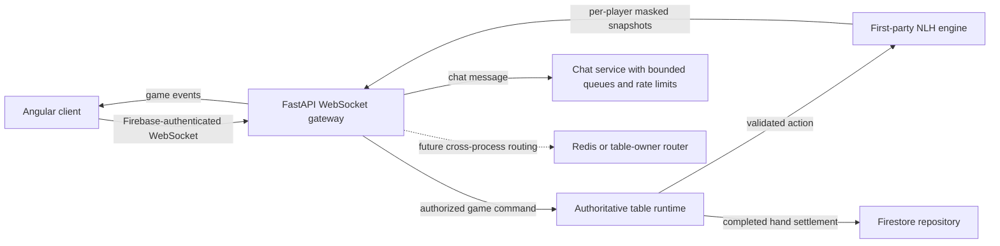

# WebSocket Architecture and NLH Engine Fit

## Purpose

This document evaluates the proposed topic-based game and chat WebSocket design against the current Cowboys PH Poker backend. The proposal is a possible direction for future scaling; its sample code is not a drop-in replacement for the current protocol.

Current club route templates call the path parameter `{club_id}`, but its value must be the UUID (`club_uuid`) returned by the membership API. The union socket's authentication field is also named `club_id` and currently expects the home-club UUID, not the 8-digit business ID.

## Current Backend

The current implementation is a single-process, authoritative table flow:

1. A player connects to `/ws/table/{club_id}/{table_id}` or `/ws/union/{union_id}/{table_id}`.
2. The server requires a Firebase ID token in the first WebSocket message, checks active membership and `PLAYER` role, and confirms the user is seated. Union sockets also verify the selected home club.
3. The server sends an authentication acknowledgement and a player-specific full state snapshot. Hole-card masking is performed for each player.
4. Incoming actions are validated and passed to `TableRuntime`, which serializes mutations with an `asyncio.Lock` and calls the first-party NLH engine.
5. After an accepted action, the runtime broadcasts a fresh, masked snapshot to each connected player. Invalid actions return an error to the acting socket.
6. Completed hands are handed to the repository for idempotent Firestore settlement. Firestore's gRPC transport is an implementation detail, not the application protocol.

The current protocol supports both the legacy message shape and an opt-in version `1.0` envelope. V1 wraps authentication, player actions, pre-actions, acknowledgements, errors, and full table snapshots. It does not add action deltas, Redis, chat, or global-game sockets. Table and connection state are process-local, so multiple application workers do not currently share one authoritative table state.

## What the UI Does

The WebSocket does not create or start a table. The UI uses REST to create the table, seat players, and start each hand. It opens a WebSocket for a seated player to receive their initial player-specific snapshot and then use the same connection for game messages.

For a local club table:

1. An `OWNER` or `MANAGER` creates the table with `POST /clubs/{club_id}/tables/{table_id}`.
2. Each `PLAYER` buys in and takes a seat with `POST /clubs/{club_id}/tables/{table_id}/seats`.
3. Each seated player connects to `/ws/table/{club_id}/{table_id}` and authenticates.
4. An `OWNER` or `MANAGER` starts the hand with `POST /clubs/{club_id}/tables/{table_id}/hands`.
5. Connected players receive a new WebSocket snapshot. Players send actions over that same socket; accepted actions cause another snapshot broadcast.

For a cross-club union table, the club players do **not** connect to each other's private club tables. They join the same table scoped to a union:

1. A `UNION_ADMIN` creates the shared table with `POST /unions/{union_id}/tables/{table_id}`, choosing an active member club as the origin.
2. A player from Club A takes a seat using `POST /unions/{union_id}/tables/{table_id}/clubs/{club_a_id}/seats`; a player from Club B uses the same endpoint with `club_b_id`.
3. Both players connect to `/ws/union/{union_id}/{table_id}`. Each authenticates with their own Firebase token and their own verified home-club ID.
4. A `UNION_ADMIN` starts the hand with `POST /unions/{union_id}/tables/{table_id}/hands`.
5. The shared union runtime broadcasts state to all connected players across the participating clubs. Each player receives a separately masked snapshot, and each player entry includes its verified `club_id` so the UI can show the player's club.

Starting a hand broadcasts to players already connected. If a player connects after the hand starts, authentication is followed by a snapshot of the current state. The REST start-hand response is not a substitute for the per-player WebSocket snapshot.

### Legacy socket example

The existing protocol remains supported. Authenticate using the Firebase token in the first message; for a union table, include the player's home club:

```json
{"type":"authenticate","id_token":"<Firebase ID token>","club_id":"550e8400-e29b-41d4-a716-446655440000"}
```

The server responds with `{"type":"authenticated","user_id":"..."}` and then a raw table-state snapshot. A game action is sent as:

```json
{"action":"CALL"}
```

The server broadcasts a new raw snapshot to each connected player after the action is handled. Invalid actions produce `{"error":"..."}` for the acting player.

### Version 1 socket example

For a union table, the first message opts the connection into the v1 envelope. The topic identifies the union table; `club_id` in the payload identifies the player's home club for server-side membership and seat checks:

```json
{
    "version": "1.0",
    "topic": "unions/union-sun/tables/final-table/game",
    "event": "AUTHENTICATE",
    "correlation_id": "auth-1",
    "payload": {
        "id_token": "<Firebase ID token>",
        "club_id": "550e8400-e29b-41d4-a716-446655440000"
    }
}
```

The server sends an `AUTHENTICATED` envelope and then a `TABLE_SNAPSHOT` envelope. Its payload is the familiar complete table state, with club IDs on players. For example, a table can show players from two clubs:

```json
{
    "version": "1.0",
    "topic": "unions/union-sun/tables/final-table/game",
    "event": "TABLE_SNAPSHOT",
    "correlation_id": null,
    "timestamp": "2026-10-15T03:30:00+00:00",
    "payload": {
        "table_id": "final-table",
        "is_union_table": true,
        "union_id": "union-sun",
        "is_hand_running": true,
        "street": 0,
        "community_cards": [],
        "pot": 150,
        "active_turn_seat": 0,
        "players": [
            {
                "seat": 0,
                "user_id": "player-a",
                "club_id": "550e8400-e29b-41d4-a716-446655440000",
                "stack": 450,
                "hole_cards": ["As", "Ad"]
            },
            {
                "seat": 1,
                "user_id": "player-b",
                "club_id": "550e8400-e29b-41d4-a716-446655440001",
                "stack": 400,
                "hole_cards": ["??", "??"]
            }
        ]
    }
}
```

The actual snapshot has additional fields; it is a complete state, not a delta. The example shows the view for `player-a`. When delivered to `player-b`, the hole-card visibility is reversed. The UI should replace its current table state with every `TABLE_SNAPSHOT` payload and use `club_id` to label players.

To act, the client sends an envelope on the same socket:

```json
{
    "version": "1.0",
    "topic": "unions/union-sun/tables/final-table/game",
    "event": "PLAYER_ACTION",
    "correlation_id": "action-17",
    "payload": {"action": "CALL", "action_id": "action-<uuid>"}
}
```

Pre-actions use `PRE_ACTION`, with `payload.action` set to `CHECK_FOLD`, `FOLD`, or `CALL_ANY`; `null` clears the pre-action. The server returns `PRE_ACTION_SET` for this command. Invalid messages/actions return `ACTION_ERROR` with the standardized error body in `payload`. An accepted game action is reflected in subsequent `TABLE_SNAPSHOT` envelopes; the snapshots are not correlated acknowledgements.

## Fit Assessment

The proposal's separation of game and chat concerns is compatible with the domain. The first-party NLH engine is the authoritative state machine: clients send intent, the server verifies it, and only the table's authoritative runtime mutates game state. Topic routing and Redis can be introduced around that boundary later.

The proposed sample code is not safe to adopt as written:

- It accepts `user_id` from the query string and does not verify Firebase tokens, active membership, role, or seating. The current backend derives identity from a Firebase token and rejects users who are not seated `PLAYER`s.
- It publishes client messages to Redis instead of passing actions through the authoritative table runtime. Redis must not become an alternate path for mutating game state.
- It connects the socket only to the game topic; it does not actually subscribe the socket to the chat topic.
- It does not implement the claimed chat rate limiting, backpressure isolation, or event acknowledgements.
- Its card-masking example mutates `payload` in place. A shared message could then carry one player's masked data into another player's response. Masking must use immutable input or a per-recipient copy, and private cards must never be broadcast on a channel where unauthorized consumers can read them.
- Redis Pub/Sub is ephemeral and does not establish table ownership, ordering, replay, or durable delivery. It cannot by itself make an in-memory table safe across multiple workers.
- A single TCP/WebSocket connection does not guarantee game traffic is isolated from chat backpressure. Separate bounded queues, or separate sockets if strict transport isolation is required, need measurement and design.
- The Angular example has a `str` type annotation (TypeScript uses `string`) and puts a user ID in the URL. Neither should be copied into the current client, which authenticates in the first message.

## Recommended Target Architecture



Keep the current engine/runtime boundary. For horizontal scaling, assign each live table a single authoritative owner. Route commands for that table to its owner, and use Redis or another broker only for explicitly designed cross-process command delivery and event fanout. Establish ownership, failover, ordering, and duplicate handling before running the same table on multiple workers. A broker does not replace durable table ownership or recovery.

Treat game and chat as separate logical channels even if a client multiplexes them over one authenticated socket. Derive allowed topics server-side from the authenticated user, club membership, seat, and table; never let a client subscribe to an arbitrary club/table topic. Use bounded queues and rate limits for chat. If game latency must remain independent under slow clients or chat floods, use separate sockets or independently managed send queues and validate the choice with load tests.

## Versioned Protocol

Version `1.0` is opt-in per connection. A client selects it by sending an envelope as its first authentication message; existing clients may continue using the legacy shape. The server derives the expected topic from the route and verifies that the client's v1 topic matches it. The server does not trust the topic for identity or permissions.

- Client envelopes contain `version`, route-derived `topic`, `event`, a non-empty `correlation_id`, and object `payload`. Client timestamps are ignored; response timestamps are generated by the server.
- Supported client events are `AUTHENTICATE`, `PLAYER_ACTION`, `PRE_ACTION`, `PING`, and `PONG`. Supported server events are `AUTHENTICATED`, `TABLE_SNAPSHOT`, `PRE_ACTION_SET`, `ACTION_ACKNOWLEDGED`, `ACTION_ERROR`, `PING`, and `PONG`.
- An `AUTHENTICATE` payload contains `id_token`; union authentication also contains the selected `club_id`. The server still checks Firebase identity, active membership, `PLAYER` role, and seating before registering the socket.
- `PLAYER_ACTION` payloads contain `action`, optional `amount`, and a required non-empty `action_id` of at most 128 characters. Repeating the same ID and payload for the same player/table does not reapply the action; the retry receives `ACTION_ACKNOWLEDGED`. Reusing an ID with different action details returns code `40902`. A successful first action is still confirmed by the resulting snapshot.
- Current action deduplication is bounded and in process. It protects retries handled by the same live runtime, but does not survive process restart, cache eviction, or routing to another worker. Do not treat it as production-grade multi-worker idempotency until the durable action journal described below is implemented.
- The server sends `PING` periodically. The client should reply with `PONG` using the same correlation ID. If the connection has no inbound activity before the idle timeout, the server closes it with code `4408`; reconnect by authenticating again and replacing local state with the fresh snapshot. Legacy clients receive `{ "type": "ping" }` and should reply `{ "type": "pong" }`.
- WebSocket error payloads use the shared error body `{status, code, message, errors, trace_id}`. The `ACTION_ERROR` payload contains that body. Error codes are numeric and defined by the backend `ErrorCode` enum; clients display the generic `message`/`errors` values and use `trace_id` for support. Never display or depend on internal technical log messages.
- `TABLE_SNAPSHOT` remains a complete player-specific state snapshot, not a delta. Each recipient's hole cards are masked independently before envelope delivery. A reconnect authenticates again and receives a fresh snapshot.
- Correlation IDs are echoed for auth, pre-action acknowledgements, and validly correlated errors. Successful actions are confirmed by the next broadcast snapshot, whose correlation ID is null; this is not an action idempotency mechanism.
- Chat, hand-settlement notifications, action deltas, Redis, and global-game topics remain future work.

Do not place tokens or caller-selected user IDs in URLs, topics, or logs. Do not publish an unmasked game state to a shared broker channel. Topic names in the envelope are routing context only and never substitute for server-side authorization.

When distributing events across processes, send only the data appropriate to each audience. Public table events can be broadcast; private hole cards and private player state must be delivered to a specific authorized user. Do not publish an unmasked full state to a general-purpose topic and rely on every downstream consumer to mask it correctly.

## Persistence and NLH Engine

The first-party NLH engine remains in-process and authoritative for legal actions, hand progression, and gross award results. The WebSocket layer should not reimplement betting rules or broadcast client-provided state deltas as truth.

A versioned JSON codec round-trips the first-party table state: configuration/settings, seats and stacks, button rotation, pending pre-actions, replay frames, engine events, pending completed-hand audit, the complete `NLHHandState`, and 52-card deck order. Firestore checkpoints now persist this private payload for table creation and implemented mutations; it must not be exposed to clients. It does not include connection objects, active timeout tasks, or the runtime's recent action cache. Encryption, access controls, checkpoint cadence for all mutations, and turn-deadline recovery remain open.

The repository defines transaction primitives for `clubs/{club_uuid}/tables/{table_id}/runtime/state` and `unions/{union_id}/tables/{table_id}/runtime/state`. The state carries a schema version, sequence, owner ID, fencing epoch, and checkpoint; `state/actions/{sha256(user_id + action_id)}` stores an accepted action fingerprint and sequence. `commit_table_action` checks the expected sequence, checkpoint owner/epoch, and matching unexpired lease owner/generation in one Firestore transaction before writing the checkpoint and action record. The repository also defines transactional lease claim, renewal, authorization, and release operations under `runtime/lease`, including fencing-generation updates. With Firestore enabled, `TableRuntime` commits first-party hand starts, explicit player actions, standalone pre-actions, and timeout actions through this transaction; club/union buy-ins atomically couple balance, seat, ledger, checkpoint, and action-journal writes under the lease. Table creation initializes a generation-zero unowned checkpoint, with union metadata and checkpoint written atomically. Firestore worker sessions and scope-aware worker routes use durable assignment and lease records, and worker claims restore absent runtimes from their checkpoints. In opt-in gateway/worker mode, Pub/Sub forwards player/pre-action commands to the lease owner and returns user-masked snapshots to gateways using Redis socket presence. REST table mutations, settings/lifecycle persistence, secure checkpoint storage, and full cross-worker retry/recovery validation remain outstanding.

The current runtime delegates completed-hand persistence and balance updates to the repository, which uses pending settlement records and idempotent Firestore operations. Keep this as one logical settlement workflow. Do not assume that it is one gRPC write: Firestore's internal transport and transaction behavior are not the WebSocket protocol, and the repository owns those details.

## Multi-Worker Ownership and Recovery Design

The implementation is not yet fully multi-worker safe. `tables`, runtime locks, connection lists, and recent action IDs remain process-local. When Firestore is enabled, worker sessions and scope-aware worker claim/list/heartbeat/release routes use durable records; a worker claim can lazily restore an absent runtime from its checkpoint before claiming the durable lease. Table state mutations and buy-ins commit checkpoints under the lease. In opt-in gateway/worker mode, WebSocket player/pre-action commands route to the current lease owner and masked snapshots return through Redis-tracked gateway presence. REST mutations are not yet owner-routed, table discovery remains request-driven, and settings/lifecycle changes are not all transactionally checkpointed. Session affinity alone is insufficient. Do not increase worker count for live tables until all REST mutations, command retries, and crash/recovery behavior are implemented and tested.

1. Assign each canonical table key (club or union scope plus table ID) one owner. Firestore worker claims now use atomic lease primitives with incrementing fencing generations, and worker requests must include the table scope. Every owner-routed command and persisted write must carry the epoch, and mutations must check ownership and expiry in the same transaction as the write. A worker with an expired or older epoch must be rejected, even if it resumes after a pause.
2. Route REST mutations and WebSocket game actions to the owner. WebSocket player/pre-action forwarding is implemented behind opt-in Pub/Sub/Redis gateway/worker mode; REST mutations still need routing. Gateways authenticate and authorize as they do now, then forward the command with authenticated user ID, table key, action ID, payload hash, and fencing epoch. The gateway must not mutate a local copy. Keep the owned engine as the only game-state authority.
3. Firestore-backed player-action IDs and payload fingerprints are written to the action journal in the checkpoint transaction for implemented mutation paths. Complete consistent result replay for duplicate deliveries and reconnects; without Firestore, the 4,096-entry cache is process-local. Redis presence and Pub/Sub transport are routing only and are not the idempotency or game-state authority.
4. Persist a versioned canonical table state and monotonically increasing sequence. The NLH hand/deck codec, initial table checkpoints, lease-guarded mutations, and scoped claim-time checkpoint restoration are implemented. Secure storage, recovery replay after partial checkpoint/journal history, and some table lifecycle/settings mutations remain outstanding. Persist private state with access controls and encryption; public snapshots must never contain a deck or opponents' unrevealed cards. Keep an ordered journal of accepted commands after the checkpoint and replay it to recover.
5. On owner loss, wait for lease expiry, acquire a higher fencing epoch, load the latest checkpoint, replay the journal, reconcile pending hand settlement through the existing idempotent repository workflow, and only then accept actions. Clients reconnect and receive a new full, player-masked snapshot. Never run old and new owners concurrently.
6. Test concurrent lease acquisition, delayed old-owner writes, retries crossing workers, crash/restart mid-hand, replay determinism, private-card masking, and settlement duplication before enabling multi-worker deployment. If recovery or lease state is uncertain, keep the table unavailable for operator recovery instead of accepting actions on incomplete state.

## Implementation Status and Next Tasks

### Implemented

- [x] Opt-in v1 envelope for authentication, player actions, pre-actions, acknowledgements, errors, and full snapshots; legacy message shapes remain supported.
- [x] Server derives the expected table topic and rejects a mismatched client topic.
- [x] Local and union WebSocket paths verify Firebase identity, active membership, `PLAYER` role, and seating; union sockets verify the player's home club.
- [x] Union integration coverage connects players from different clubs before starting a hand and checks start broadcasts, club IDs, and per-recipient hole-card masking.
- [x] Shared `ErrorCode` enum and safe REST/WebSocket error bodies with trace-linked structured server logs.
- [x] V1 action IDs with in-process duplicate suppression, conflicting-ID rejection, server PING/PONG, and idle connection cleanup.
- [x] Integration coverage for malformed JSON, invalid tokens, generic errors, duplicate actions, and stale idle sockets.
- [x] Firestore repository primitives for transactional lease claim, renewal, authorization, and release with durable fencing generations.

### Remaining

- [ ] Update the Angular socket service to use v1 envelopes and action IDs, replace UI state from full snapshots, display union players' `club_id`, answer `PING` with `PONG`, and map numeric errors to UI states.
- [ ] Expand auth/error tests for wrong home-club selection and role changes; test idempotency across cache eviction and future worker boundaries.
- [ ] Measure bounded outbound queues and slow-client behavior; heartbeat/idle cleanup currently covers liveness, not backpressure isolation.
- [x] Wire durable lease operations into worker/runtime routes and enforce lease owner, generation, and expiry atomically with checkpoint/action writes and buy-ins.
- [ ] Complete cross-process routing for REST mutations, command redelivery/deduplication, checkpoint replay, and failover before enabling multiple workers; WebSocket player/pre-action routing is implemented behind opt-in Pub/Sub/Redis mode.
- [ ] Add chat as a separately authorized, moderated, rate-limited feature; benchmark whether one socket with independent bounded queues is sufficient or separate sockets are required.
- [ ] Measure action-to-snapshot latency and payload sizes under representative loads. Validate any target such as 100+ tables with reproducible tests instead of assumptions.

The acceptance checks should include per-recipient frame inspection for private-card masking, cross-club union play, chat-flood isolation once chat exists, Firestore settlement idempotency, and multi-worker/failover behavior before production scaling.
